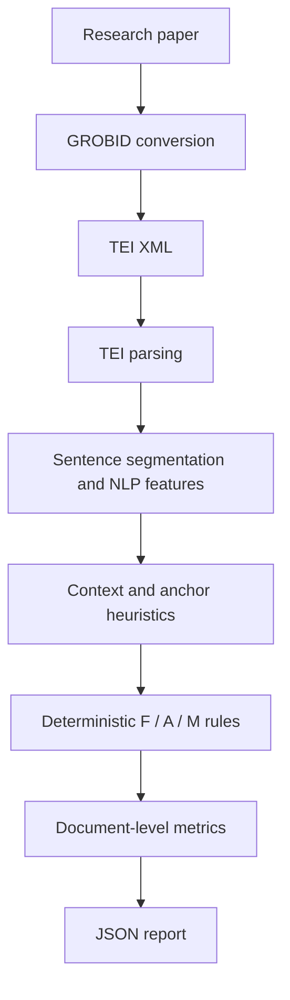

# Epistemis

**A deterministic, rule-based prototype for analysing epistemic and rhetorical patterns in scientific writing.**

Epistemis parses GROBID TEI XML, segments scientific text into sentences, extracts linguistic and contextual signals, and applies explicit rules to flag selected patterns of rhetorical overstatement. It is a research prototype—not a system that determines whether a paper is true, deceptive, biased, or scientifically invalid.

## What is implemented

The maintained runtime combines three components:

- **TEI preprocessor:** parses GROBID TEI XML; extracts paragraph, figure-caption, and table text; segments sentences with spaCy; assigns structural and epistemic features; and detects and links selected evidence-anchor signals.
- **Rule-based classifier:** applies F-series rules and emits supported A-series and M-series labels.
- **Document metrics:** summarizes label counts/distributions, anchor use, heuristic scores, and exploratory diagnostics.

The implementation wired by the last stable metrics pipeline used `preprocessor_versions/preprocessor_v2.py`, `Classifier_versions/Project_v1_5.py`, and `metrics_engine.py`. These are consolidated in `src/epistemis/` for the maintained package.

## Pipeline



The package starts from **TEI XML**. PDF-to-TEI conversion is an external preprocessing step, not part of the package CLI.

## Labels

- **F-series:** primary heuristic flags — F1 (interpretive generalisation), F2 (causal escalation), F3 (unsupported causal/relational claim under the current rule implementation).
- **A-series:** secondary rhetorical patterns — authority, consensus, loaded evaluation, and novelty-related signals.
- **M-series:** modifiers — hedging, boosting, downtoning, emphasis, and discourse markers.

See [taxonomy and implementation mapping](docs/taxonomy.md) for the exact conditions and inactive categories.

## Installation

Requires Python 3.10 or later.

```bash
python -m venv .venv
# Windows: .venv\\Scripts\\activate
# macOS / Linux: source .venv/bin/activate
python -m pip install --upgrade pip
python -m pip install -e ".[dev]"
python -m spacy download en_core_web_md
```

The spaCy language model is installed separately from the Python package. Install a model version compatible with the spaCy version in your environment.

## Run

Supply a GROBID TEI XML file that you are permitted to process:

```bash
epistemis path/to/document.tei.xml --output outputs/document_metrics.json
```

Or run `python -m epistemis path/to/document.tei.xml --output outputs/document_metrics.json`. Add `--debug-sentences outputs/sentences.jsonl` to write optional sentence-level debug records. Debug output is not generated automatically.

## Repository map

```text
src/epistemis/      Maintained package
docs/               Architecture, methodology, taxonomy, limitations, data policy
examples/           Small synthetic TEI example
tests/              Parser and metrics tests
archive/            Earlier source versions and research notes
```

## Research status and limitations

- The runtime is **deterministic and rule-based**. DistilBERT/SciBERT protocols in the archive are research notes, not integrated or trained models in this release.
- Heuristic scores are not probabilities or calibrated confidence.
- Citation presence or a detected anchor does not establish that the cited evidence supports a claim.
- Rules can produce false positives and false negatives. They require evaluation against independently annotated documents before performance claims can be made.
- Document diagnostics are descriptive implementation metrics, not substitutes for precision, recall, F1, calibration, or inter-annotator agreement.

Read [methodology](docs/methodology.md) and [limitations](docs/limitations.md) before interpreting results.

## Data and licensing

The paper corpus, extracted full-text TEI documents, and intermediate JSONL datasets are intentionally omitted from this cleaned branch because redistribution rights were not established in the repository audit. Use only documents and derived data that you have permission to process and share.

**No open-source software licence has been assigned.** Until the author chooses and adds a licence, do not assume that the code is licensed for reuse or redistribution. See [data and licensing policy](docs/data-policy.md).

See [CITATION.cff](CITATION.cff) for citation metadata.
